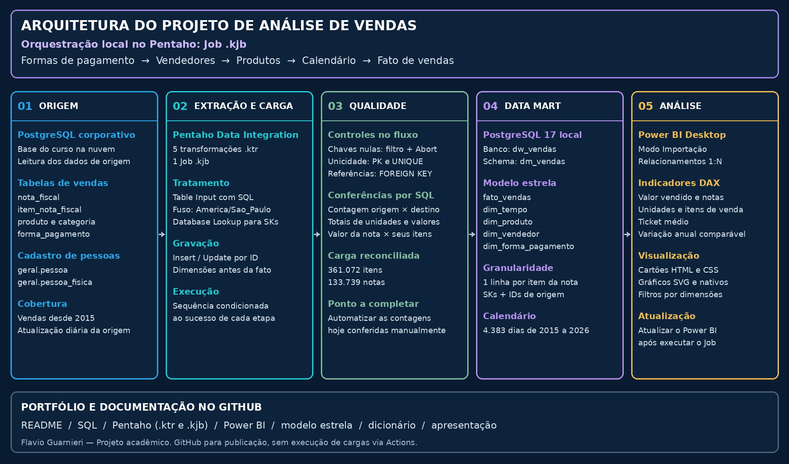
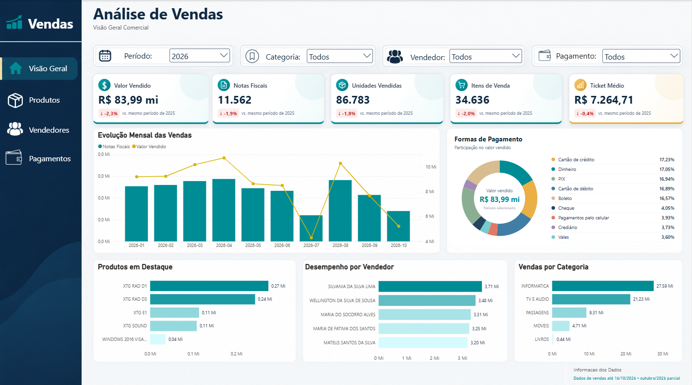

# Análise de Vendas com Data Mart e Power BI

Projeto desenvolvido por **Flavio Guarnieri** como trabalho final
do Módulo 02 da Formação Data Analytics.

O projeto utiliza PostgreSQL, Pentaho e Power BI para organizar
dados de vendas em um modelo dimensional e apresentar análises
de desempenho comercial.

## Objetivo

Construir e popular um Data Mart de vendas que permita acompanhar
a evolução das vendas, identificar a contribuição de produtos
e categorias, comparar vendedores e analisar formas de pagamento.

## Perguntas de negócio

1. Como o valor vendido e a quantidade de notas evoluem ao longo dos meses?
2. Quais produtos e categorias mais contribuem para o valor vendido?
3. Quais vendedores apresentam maior valor vendido e maior quantidade de notas?
4. Como o valor vendido se distribui entre as formas de pagamento?

## Tecnologias utilizadas

| Tecnologia | Aplicação |
|---|---|
| PostgreSQL | Banco de origem e armazenamento do Data Mart |
| pgAdmin | Exploração, criação das tabelas e validações SQL |
| Pentaho Data Integration | Extração, transformação e carga |
| Power BI | Modelo analítico, medidas DAX e dashboard |
| HTML, CSS e SVG | Cartões personalizados e gráficos no HTML Content |

## Arquitetura

 

O fluxo começa na base corporativa disponibilizada pelo curso.
O Pentaho extrai os dados, aplica os tratamentos e carrega
o Data Mart no PostgreSQL local.

O Power BI consulta o Data Mart em modo Importação.
Após executar o Job, é necessário atualizar o relatório.

O GitHub reúne o código e a documentação do projeto.
A execução das cargas ocorre localmente pelo Pentaho.

## Modelo dimensional

O banco de destino é `dw_vendas`, com as tabelas no schema `dm_vendas`.

| Tabela | Finalidade |
|---|---|
| fato_vendas | Quantidades e valores dos itens vendidos |
| dim_tempo | Calendário e atributos de data |
| dim_produto | Produtos e suas categorias |
| dim_vendedor | Identificação dos vendedores |
| dim_forma_pagamento | Modalidades de pagamento |

### Granularidade

Cada linha da `fato_vendas` representa um item de nota fiscal da origem.

Uma nota com três itens gera três linhas na fato.
A quantidade de unidades vendidas corresponde à soma de `quantidade`.
A quantidade de notas utiliza a contagem distinta do identificador da nota.

As dimensões cadastrais possuem chaves substitutas e identificadores
de origem. Os atributos seguem atualização por sobrescrita,
sem histórico de versões cadastrais.

## Pipeline de ETL

O Job do Pentaho executa as cargas nesta ordem:

1. Formas de pagamento.
2. Vendedores.
3. Produtos.
4. Calendário.
5. Fato de vendas.

O avanço entre as etapas depende do sucesso da execução anterior.

### Principais operações

- Leitura da origem com Table Input e SQL.
- Conversão das datas para o fuso `America/Sao_Paulo`.
- Busca das chaves substitutas com Database Lookup.
- Validação de chaves ausentes com Filter Rows e Abort.
- Gravação com Insert / Update, utilizando o identificador de origem.
- Proteção de integridade com chaves primárias, estrangeiras e restrições UNIQUE.

## Validações

Durante a construção, foram realizadas verificações de:

- Notas sem itens e itens sem nota correspondente.
- Referências de produtos, categorias, vendedores e formas de pagamento.
- Campos nulos ou vazios.
- Identificadores duplicados.
- Continuidade e unicidade do calendário.
- Igualdade entre quantidade × valor unitário e valor total do item.
- Igualdade entre a soma dos itens e o valor da nota.
- Contagens e totais entre origem e destino.
- Repetição da carga sem duplicação de registros.

A validação de chaves ausentes integra o fluxo da fato.
Parte das conferências de contagem e reconciliação foi executada
manualmente por SQL. Sua automação é uma melhoria prevista.

## Resultado da carga validada

Totais históricos reconciliados em **19/10/2026**, sem filtro anual:

| Indicador | Resultado |
|---|---:|
| Itens de venda | 361.072 |
| Notas fiscais distintas | 133.739 |
| Unidades vendidas | 902.487 |
| Valor vendido | R$ 880.718.318,83 |
| Produtos na dimensão | 233 |
| Vendedores na dimensão | 24 |
| Formas de pagamento | 9 |
| Datas no calendário | 4.383 |

Esses números representam a carga conferida nessa data.
Novas execuções podem apresentar outros totais, pois a origem recebe atualizações.

## Dashboard

O painel apresenta:

- Valor vendido.
- Quantidade de notas fiscais.
- Unidades vendidas.
- Itens de venda.
- Ticket médio.
- Variação em relação ao mesmo período do ano anterior.
- Evolução mensal das vendas.
- Produtos, vendedores e categorias em destaque.
- Participação das formas de pagamento no valor vendido.

As comparações anuais consideram períodos equivalentes.
O último mês disponível recebe indicação quando está parcial.

Os visuais HTML respondem aos filtros recebidos do Power BI.
A seleção de elementos HTML para filtrar outros visuais depende
de configuração adicional.

## Execução do projeto

1. Preparar o PostgreSQL local e criar o banco e as tabelas de destino.
2. Configurar as conexões de origem e destino no Pentaho.
3. Ajustar os caminhos dos arquivos referenciados pelo Job.
4. Executar as dimensões e, em seguida, a fato.
5. Conferir logs, contagens e totais.
6. Conectar o Power BI ao banco de destino.
7. Atualizar o relatório para importar a carga mais recente.

O acesso à origem depende das credenciais fornecidas pelo curso.
Credenciais não devem ser publicadas neste repositório.

## Limitações e próximos passos

- Automatizar as conferências de contagem e reconciliação no ETL.
- Ampliar o registro de execução e tratamento de falhas.
- Investigar oscilações mensais antes de atribuir causas.
- O processo de Insert / Update não remove automaticamente registros
  que tenham sido excluídos da origem.
- O modelo não utiliza custo histórico para calcular lucro.
- A reprodução completa depende do acesso autorizado à base do curso.

## Autor

**Flavio Guarnieri**

Projeto acadêmico para desenvolvimento de competências
em análise de dados, ETL, modelagem dimensional e visualização.
